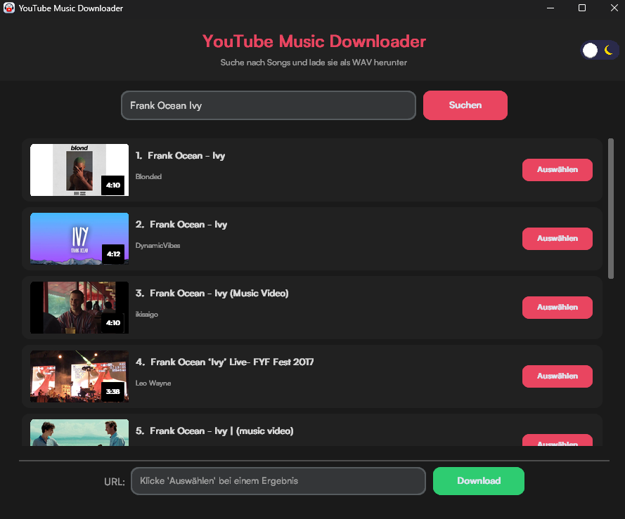

# YouTube Music Downloader

A modern desktop application to search and download audio from YouTube videos as high-quality WAV files. Built with Python and CustomTkinter, featuring a sleek dark/light theme UI with animated toggle.

---

## Preview



---

## Features

- **Song Search** — Search for any song or video by name, powered by yt-dlp
- **10 Results** — Displays up to 10 search results with thumbnails, titles, channel names and duration
- **One-Click Select** — Click "Auswählen" to pick a result for download
- **Tidy Layout** — Separate tabs for **Suche** (single songs) and **Playlist**; less-used options live in **Einstellungen**
- **Playlist Import** — Load an exported Spotify playlist (JSON or CSV) and download every song in order
- **High-Quality WAV** — Downloads the best available audio and converts to uncompressed WAV (44.1 kHz, 16-bit, stereo)
- **Dark / Light Theme** — Animated theme toggle with sun/moon icons
- **Cross-Platform** — Available for Windows, macOS and Linux as standalone executables

---

## Download

Download the latest release for your platform from the [Releases](../../releases) page.

| Platform | File |
|----------|------|
| Windows  | `YT-Music-Downloader-Windows.zip` |
| macOS    | `YT-Music-Downloader-macOS.zip` |
| Linux    | `YT-Music-Downloader-Linux.zip` |

Extract the ZIP and run the executable. FFmpeg is bundled — no extra setup required.

---

## Run from Source

### Prerequisites

- Python 3.10+
- FFmpeg installed and added to your system PATH

### Installation

```bash
pip install customtkinter yt-dlp Pillow requests mutagen
```

`mutagen` is only needed to embed cover art — without it the app runs fine and the
**Cover einbetten** switch in **Einstellungen** is greyed out.

### Start

```bash
cd YT-MP3-Downloader-main
python main.py
```

---

## How It Works

1. On the **Suche** tab, enter a song name and click **Suchen**
2. Browse the results — each card shows a thumbnail, title, channel and duration
3. Click **Auswählen** on the song you want
4. The URL is filled in automatically (or paste one yourself) — click **Download**
5. The WAV file is saved to your `Downloads` folder

---

## Playlist Import

Export your Spotify playlist with any export tool (e.g. [Exportify](https://exportify.net), which
gives you a CSV or JSON file), then:

1. Switch to the **Playlist** tab, click **Playlist-Datei öffnen** and pick the exported `.json` or `.csv` file
2. The track list appears in playlist order — check it, then click **Alle herunterladen**
3. Every track is searched on YouTube and downloaded as WAV into
   `Downloads/<Playlist name>/`, numbered so the order is preserved
   (`01 - Artist - Title.wav`, `02 - ...`)

### Picking the right video

A YouTube search for a song returns the studio version, but also live recordings, covers,
lyric videos and — worst of all — completely different songs from the same artist. Each
candidate is therefore scored, and the best one only wins if it clears a minimum score
(`MIN_MATCH_SCORE`):

- **the song title must appear in the video title** — otherwise the result is dropped outright.
  This is what stops "BHZ - So Leben Kann" from being satisfied by "BHZ - SO HOCH"
- **track length** from the export: within a few seconds scores high, a minute off scores negative
- **artist in the channel name** scores higher than the artist merely in the title;
  auto-generated `… - Topic` channels score highest
- **words like live, cover, remix, karaoke, nightcore, tutorial** cost 100 points — but only when
  they are *not* part of the requested title, so a song actually called "Live Forever" is safe

**If nothing clears the bar, the song is not downloaded at all** and is reported as
"Kein Treffer gefunden". A missing song is easier to fix than a wrong one sitting in the folder
under the right name.

Search terms are cleaned up too: only the primary artist is used (`BHZ;Monk;Big Pat` → `BHZ`)
and Spotify decorations are stripped (`Don't Let Me Down - Remastered 2009` →
`Don't Let Me Down`, `Wellen (feat. Monk)` → `Wellen`). File names keep the full original,
so resuming still recognises what was already downloaded.

Notes:

- Files that already exist are skipped, so an interrupted run can simply be restarted.
  A song is matched by its name, not by its position — if you re-export the playlist after
  adding or reordering songs, existing files are renamed to their new position instead of
  being downloaded again. Switching the audio format does re-download everything (different
  file extension), and so does renaming the playlist (different target folder).
- **Abbrechen** stops the run after the songs currently in flight
- At the end you get a summary listing any tracks that could not be found
- Long playlists show the first 150 rows; the rest is downloaded all the same

### Watching progress

While a playlist is running, every finished song is reported three ways:

- the status line at the bottom shows `812/3033 Songs · 3 gleichzeitig · OK  Artist - Title`
- the same line is printed to the console when started from source
- everything is appended to `_download-log.txt` inside the playlist folder, with timestamps

```
=== 02.08.2026 13:32 · Meine Playlist · 3033 Songs · WAV · unkomprimiert · 3 gleichzeitig ===
13:32:19  [ 1/3033] OK        Artist - Title
13:32:41  [ 2/3033] schon da  Artist - Other Title
13:33:04  [ 3/3033] FEHLER    Artist - Third Title  (Altersbeschränkt)
--- geladen: 2841 · übersprungen: 145 · fehlgeschlagen: 47
```

The log survives the run, so after an overnight download you can see exactly what happened
and when — useful since yt-dlp's own console output is suppressed.

### When downloads fail

YouTube rejects a fair share of requests. The app reacts differently depending on why:

| Error | Reaction |
|---|---|
| `HTTP Error 403 / 429`, connection errors | Throttling or a hiccup — same video is retried up to 3× with a growing pause, then the next search result is tried |
| `Sign in to confirm your age` | Age-gated — moves straight to the next search result; set **Cookies** (in **Einstellungen**) to a browser you are signed in to if you want the original |
| `This video is not available` | Dead video — moves straight to the next search result |
| `Sign in to confirm you're not a bot` | YouTube flagged your IP — **the run stops immediately**, since every remaining song would fail too |
| `Requested format is not available` | Reported as "Keine Tonspur geliefert". Despite the wording this is rarely a broken video: a flagged IP gets responses with no playable audio streams. Treat a flood of these like the bot check |
| FFmpeg missing | **Stops immediately** — no song can be converted without it |
| 20 failures in a row | **Stops immediately** — something systemic is wrong (no internet, IP blocked) |

The three "stops immediately" cases exist so a blocked IP does not burn through the rest of a
3000 song playlist. The dialog names the cause and what to change; everything already
downloaded is kept, so you fix the cause and start again.

Each song has up to 3 candidate videos, so a blocked or deleted upload usually still ends up
downloaded. The final summary groups what is left by cause and tells you what to change.

To reduce the chance of being flagged in the first place, each playlist download waits a
random 2–6 seconds beforehand (`SLEEP_BETWEEN` in `ytmd/config.py`; single downloads are not
delayed). Getting blocked costs far more time than the pause does.

**A wave of 403s almost always means too many parallel downloads.** Set **Gleichzeitig** (in **Einstellungen**) to 1
or 2 and start again — finished songs are skipped, so only the missing ones are fetched.
It is also worth keeping yt-dlp current, since YouTube changes its defenses regularly:

```bash
pip install -U yt-dlp
```

### Speed

**Gleichzeitig** (in **Einstellungen**) sets how many songs are downloaded in parallel —
3 by default, up to 6. A 3000 song playlist takes roughly a day one at a time, about
7 hours with three at once. Track order is not affected: the position is baked into the file
name (`0001 - Artist - Title.wav`), no matter which download finishes first. If YouTube starts
throttling or downloads begin to fail, lower the value.

### Cover art

With **Cover einbetten** switched on in **Einstellungen** (default), the artwork is written *into* the audio file —
no separate image files. It comes from the Spotify export, at the largest size offered, so
it is the same artwork Spotify shows. Exports without artwork (`Album Image URL` in
Exportify CSV, `album.images` in API JSON) fall back to the YouTube thumbnail of the
matched video.

| Format | How the cover is stored | Player support |
|--------|------------------------|----------------|
| MP3    | ID3 `APIC` frame | everywhere |
| FLAC   | native picture block | everywhere |
| WAV    | ID3 chunk appended to the RIFF file | patchy — see below |

**WAV has no standard cover field.** An ID3 chunk can be appended, and the file stays a
valid WAV (verified: Python's `wave` module and `ffprobe` read it unchanged, it only grows
by the size of the image). But not every player looks for it. If cover art matters to you,
FLAC is the better choice — lossless like WAV, roughly half the size, and artwork works
everywhere.

Songs already downloaded in an earlier run get their cover added on the next start without
re-downloading the audio. Files that already contain a cover are skipped, and one album's
artwork is fetched once no matter how many of its tracks are in the playlist.

If the export has no artwork column at all, an existing song has no image source — nothing
was searched for it, after all. In that case one extra YouTube search per uncovered song is
made just to get its thumbnail. That costs a request per song, so it can be turned off with
`COVER_SEARCH_FOR_EXISTING = False` in `ytmd/config.py`.

For real Spotify artwork instead of a video thumbnail, re-export the playlist with the
**Album Image URL** column enabled — then no extra search happens at all.

Whatever happens, the final summary states it plainly:

```
Cover eingebettet: 2841  (ohne Cover: 47)
```

### Disk space

Uncompressed WAV is big — roughly **35 MB per song**. Before starting, the playlist card shows
the estimated total, the target folder and how much space is free there:

| Format | per minute | 3000 songs |
|--------|-----------:|-----------:|
| WAV (uncompressed) | 10 MB | ~105 GB |
| FLAC (lossless)    | 5.7 MB | ~59 GB |
| MP3 320 kbps       | 2.3 MB | ~24 GB |
| MP3 192 kbps       | 1.4 MB | ~14 GB |

Pick a format under **Format** at the bottom (it applies to single downloads too), or set the
**Zielordner** in **Einstellungen** to an external drive. If the space still would not be enough, the
app warns before it starts and — should the drive fill up anyway — stops cleanly instead of
running the disk to zero. Already downloaded songs are kept, so you can free up space and
restart to continue where it left off.

Supported export shapes: raw Spotify API responses (`items` / `tracks.items` with
`track.name` + `artists`), Exportify CSV/JSON (`Track Name`, `Artist Name(s)`,
`Duration (ms)`), and simple lists of `{"title": ..., "artist": ...}` objects.

---

## Project Structure

```
YT-MP3-Downloader-main/
├── main.py            Entry point – sets the theme and starts the window
└── ytmd/
    ├── config.py      Constants: colors, font, search limits, audio settings
    ├── utils.py       Download folder, FFmpeg path, file names, durations
    ├── youtube.py     yt-dlp layer: search, best-match, audio download
    ├── playlist.py    Reads playlist exports (JSON/CSV) into `Track` objects
    ├── downloader.py  Playlist download loop – reports progress via callbacks, no UI
    ├── images.py      Thumbnail loading and rounded corners
    ├── widgets.py     Custom widgets (animated theme toggle)
    └── app.py         Window, layout and event handling
```

`downloader.py` and `playlist.py` are free of GUI code, so playlist handling can be
tested and reused without opening a window.

---

## Tech Stack

- **CustomTkinter** — Modern themed GUI toolkit
- **yt-dlp** — YouTube search and audio extraction
- **FFmpeg** — Audio conversion to WAV
- **Pillow** — Thumbnail loading and image processing
- **PyInstaller** — Cross-platform packaging as standalone executables

---

## Disclaimer

This project is for educational purposes only. Downloading copyrighted material may violate YouTube's terms of service and the laws of your country. Please use this tool responsibly and respect copyright laws.
